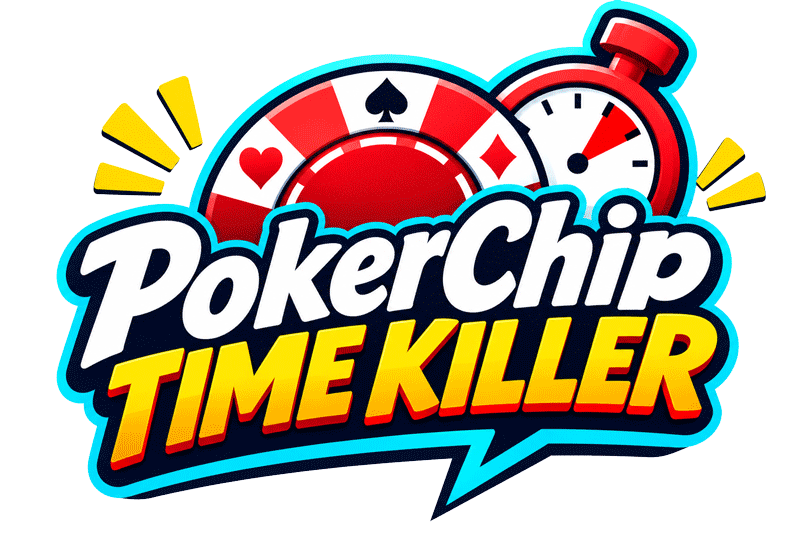
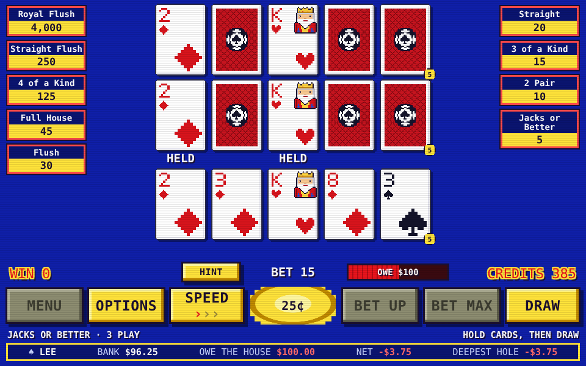

# PokerChip Time Killer

A 16-bit style video poker game for the browser, modeled after classic casino cabinets. It uses play money only.

## Features
- **Games:** Jacks or Better (9/6), Bonus Poker (8/5), Double Double Bonus (9/6), Deuces Wild (full pay) and Joker Poker (Kings or Better)
- **Hands:** play 1, 3, 5 or 10 at once
- **Bets:** 5¢, 25¢, $1 or $5 denominations; Bet Up and Bet Max
- **Double Up:** pick a card to beat the dealer's
- **HINT:** works out the best hold by checking every possible draw
- **House loans:** you start with a $100 loan from the house. The game tracks your bankroll, what you owe, your net result and your deepest hole, for each player.
- **Art and sound:** original pixel-art cards and chiptune sound effects

## Play
Open `index.html` in any modern browser. It's a single self-contained file. Landscape is best on phones.

**Keys:**
- Space or Enter: deal / draw
- 1–5: hold cards
- U: bet up
- M: bet max
- H: hint
- S: speed

## Develop
- `src/engine.js`: deck, crypto-secure shuffle, hand evaluator and exact-EV hint solver
- `src/cards.js`: pixel card art, drawn on a canvas
- `src/template.html`: user interface, styles and game flow
- `python3 build.py`: rebuilds `index.html` from `src/`
- `cd src && node engine.test.js`: checks all 2,598,960 starting hands against textbook counts

Player data is saved in the browser's localStorage.
